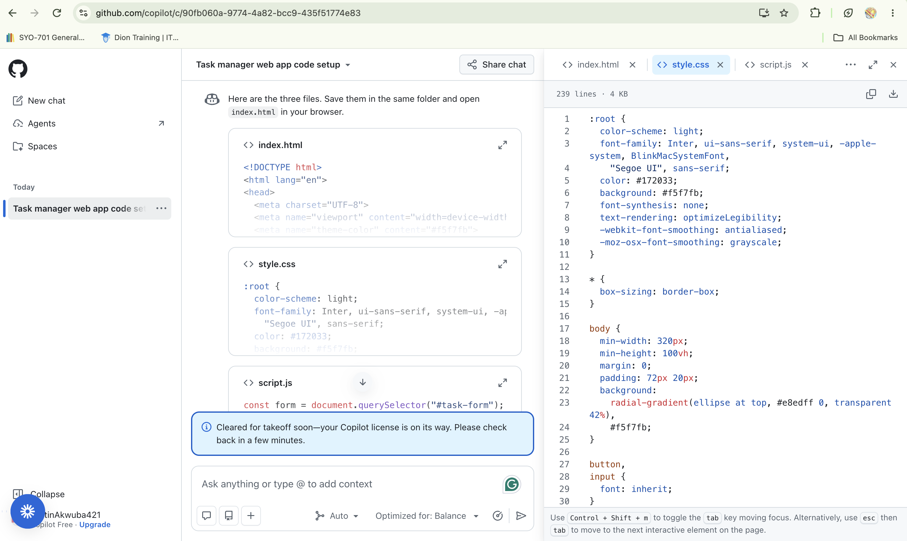
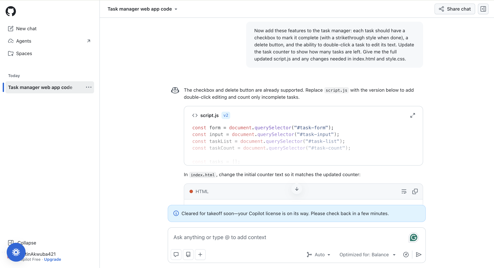
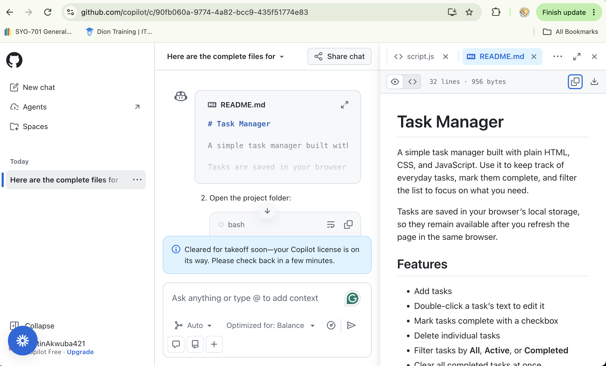

# Reflection: Building a Task Manager with GitHub Copilot

## 1. What did you ask Copilot to help you build? How did you break down the problem?

I asked Copilot to help me build a simple task manager web app using HTML, CSS, and JavaScript. I broke the project into small steps instead of asking for everything at once. First I asked for the basic page structure with a header, input box, and task list. Then I added features one at a time: marking tasks complete, deleting and editing tasks, filter buttons, and saving tasks so they stay after refreshing the page.

## 2. How did your approach to asking questions change as you worked?

At first my prompts described the whole page in general terms. As I went on, my prompts got more specific. I listed the exact features I wanted and asked Copilot to give me the full updated files so I could paste them in without mixing up old and new code. I also learned to keep using the same chat so Copilot remembered my earlier code.

## 3. What parts of the development process with GitHub Copilot surprised you?

I was surprised how good the first version looked with very little direction. Copilot gave it a clean, modern design right away. I was also surprised that Agent mode required a paid plan, so I used the chat in Ask mode and copied the code into my files myself. Another surprise was that the web version of Copilot can't see my files, so I had to paste my code in when I asked it to write the README.

## 4. What did you learn about the technology you used that you didn't know before?

I learned how localStorage lets a web page save data in the browser so it is still there after a refresh. I also learned how to use the Live Server extension to test my page, and how to set up Git on a Mac, which needed the developer tools installed first. Making commits after each feature also showed me how Git keeps checkpoints of my work.

## 5. What would you do differently if you had to build this again?

I would plan my feature list before starting so my prompts were clear from the beginning. I would also test each feature right after adding it and take screenshots as I go. If I had access to Agent mode, I would try it to see how it compares to copying and pasting code myself.

